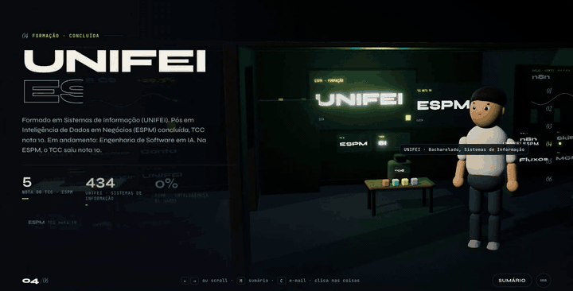
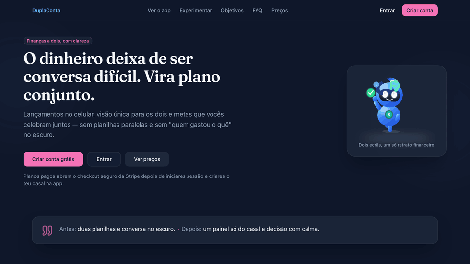

<h1 align="center">Hi, I'm Davi Braga 👋</h1>

  

  I turn <b>credit-limit experiments into decisions</b> and build <b>applied AI</b> that survives production: 
  LLMs, RAG, agents and MCP, measured on cost and graded by code.

  
   
  ▶ <a href="https://davi-diorama.vercel.app"><b>Step into my 3D résumé</b></a>: scroll through the room, click the objects, or open “Fale com o Davi” and ask me something.

  
  
  
  

---

### About me

- 💳 I work where **credit, data and AI** meet: limit policies, experiments and decision systems across **Brazil, Mexico and Colombia**.
- 🤖 I build AI systems meant for **production, not demos**: agents, RAG pipelines, model routing and evals graded by code.
- 🎓 B.Sc. in Information Systems (UNIFEI). Graduate studies in **Software Engineering with Applied AI** and **Data Intelligence for Business** (ESPM).

### Building now

<table>
  <tr>
    <td width="52%" valign="top">
      
    </td>
    <td valign="top">
      💸 <b><a href="https://couple.ddflowapp.tech">DuplaConta</a></b> · <i>live product</i>  
      A money app for couples: one shared picture of the month, launches from the phone and goals you celebrate together.  
      Next.js 16 · Prisma 7 on Postgres with row-level security · WhatsApp assistant · Stripe billing. More than <b>1,200 automated tests</b> guard it, and every deploy <b>rolls back by itself</b> if the new version is not healthy.
    </td>
  </tr>
</table>

- 🧭 **agent-router** *(private)*: sends every subtask to the cheapest model that still passes a check. A script or a small “Decision AI” verifies the cheap work and escalates only when it fails, and a live panel shows each agent, its model and its cost.

### Featured projects

| Project | What it is |
| --- | --- |
| 🧊 [davi-diorama](https://github.com/DaviBragaBA/davi-diorama) | Interactive 3D résumé: a Three.js diorama with a GSAP scroll tour and a scripted Q&A · [live](https://davi-diorama.vercel.app) |
| 🧰 [fabrica](https://github.com/DaviBragaBA/fabrica) | Portable harness for AI coding agents: ten skills and two agents for grilling ideas, specs, minimal diffs and approval gates |
| 🧩 [Prompt-Json](https://github.com/DaviBragaBA/Prompt-Json) | Prompt Studio: a short form in, a structured JSON prompt for Cursor or any AI tool out · [live](https://davibragaba.github.io/Prompt-Json/) |
| 🌐 [meu-portfolio](https://github.com/DaviBragaBA/meu-portfolio) | Résumé site: a statically generated Next.js 16 app in Portuguese and English · [live](https://davi-braga-portfolio.vercel.app) |

### In numbers

| 4.5+ | 97 | 1,200+ |
| :---: | :---: | :---: |
| years working with data | mobile Lighthouse performance on a WebGL site | automated tests guarding a production app |

### Tech stack

  

**AI:** LLMs · RAG · agents · MCP · Qdrant · n8n · evals · model routing

### GitHub activity

  
  

  

<picture>
  <source media="(prefers-color-scheme: dark)" srcset="https://raw.githubusercontent.com/DaviBragaBA/DaviBragaBA/output/snake-dark.svg?v=2">
  <source media="(prefers-color-scheme: light)" srcset="https://raw.githubusercontent.com/DaviBragaBA/DaviBragaBA/output/snake.svg?v=2">
  
</picture>

### What I care about

> Shipping AI that is **measured, cheap and boring to operate**. If a smaller model gets the same score, it gets the job.

  Want the short version? <a href="https://davi-diorama.vercel.app"><b>The 3D résumé</b></a> takes two minutes, or find me on <a href="https://www.linkedin.com/in/davibragamor/"><b>LinkedIn</b></a>.

